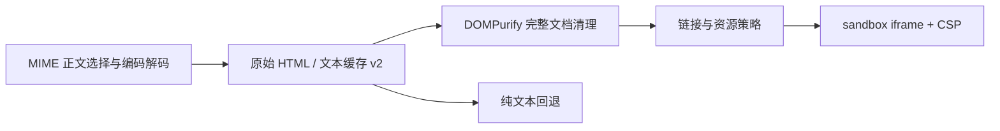

# 邮件正文预览

HTML 由浏览器排版。业务代码不维护 HTML 标签和属性白名单，也不把邮件转换为 React 节点。

同步元数据与正文预览分开处理：后端以 `BODY.PEEK[HEADER]` 读取完整邮件头，通过 go-message 解析主题、地址、日期和消息标识，再复用原消息/附件映射。部分 QQ 邮件的 `HEADER.FIELDS` 仅返回空行，不能用它替代完整头部；引号内 MIME 编码的显示名称需在地址解析后再次解码。账号正常登录却持续异常时，应检查具体同步阶段；厂商 ENVELOPE 响应解析失败不能当成凭证失效。成功提交同步批次后会清除账号异常，无需前端伪造正常状态。

## 唯一渲染流程

1. API `mail/service/imap.go` 排除附件，优先 HTML 正文，处理 transfer encoding 和 charset，限制解码后正文为 8 MiB。保留原始 HTML；文本用于摘要、待办转换和回退。
2. 后端 `mail/repository/repository.go` 保存原始 HTML 和文本，`body_format_version = 2`。`mail/service/service.go` 命中任何版本的正文缓存都立即返回；旧格式由 `mail/service/body_cache.go` 后台升级，单消费者、32 条排队上限、相同邮件去重、每次最长 45 秒，并随服务停止取消。升级失败保留原缓存，下次打开可重试；首次没有正文缓存才同步读取远端。无需数据库迁移。
3. `mail-document.ts` 是前端唯一 HTML 处理入口。DOMPurify 使用官方 HTML profile，清理脚本、事件属性、危险协议和嵌套文档；未知包装元素的可读内容由库保留。业务层仅禁用邮件中的表单、媒体、外部样式和导航控制。
4. 保留邮件的 `html/head/body`、样式块、内联样式和语义结构。只注入可信 charset、CSP、referrer、viewport 和基础样式，不把完整文档拼进第二个 body。
5. 外链限制为 HTTP、HTTPS、mailto 和 tel；外部链接统一新窗口及 `noopener noreferrer`，页内锚点保留。相对外链不允许落到工作台路由。
6. `MailBody` 仅通过 `srcDoc` 传入独立 iframe；不授予脚本、同源、表单或顶层导航权限。邮件 CSS 不进入工作台 DOM。
7. 打开详情即自动加载 data 和 HTTP(S) 图片，无需额外按钮或确认。CSP 继续禁止外部脚本、样式表、字体、frame、表单和连接，不发送 referrer。
8. 没有可显示的 HTML 时使用纯文本。详情页继续负责请求骨架、Toast、重试和附件下载。

## 修改边界

- HTML 兼容性和安全规则跟随 DOMPurify 升级，不另起业务标签清单。
- CSS 资源通过 CSP 控制，不使用正则清理 CSS。
- `bodyHtml` 是不可信原文，调用方必须经过 `buildMailDocument`；禁止直接写入应用 DOM。
- 发送方的外部 CSS / Web 字体仍受限；CID 附件图片尚未解析，暂不支持。浏览器预览不模拟 Outlook 的 Word 排版引擎。
- 回归用例和浏览器夹具保留本地并遵守仓库忽略规则。

## 上游实现参考

- [Proton Mail：DOMPurify 邮件策略](https://github.com/ProtonMail/WebClients/blob/ad5f7c1dcc7e2f5536f1c4a417fa70554d83fb88/packages/sanitize/src/purify.ts)；[iframe 正文容器](https://github.com/ProtonMail/WebClients/blob/ad5f7c1dcc7e2f5536f1c4a417fa70554d83fb88/packages/mail-renderer/src/components/MessageBodyIframe.tsx)。参考职责划分，不复制其客户端内部转换体系。
- [Nextcloud Mail：HTMLPurifier、CSS 与图片资源处理](https://github.com/nextcloud/mail/blob/77a85a7f1f9f28adfb04b98c28c7ee5cf6ddba55/lib/Service/Html.php)。参考内容清理与资源策略分离；当前采用浏览器 CSP，不增加服务端图片代理。
- [DOMPurify 官方使用与安全边界](https://github.com/cure53/DOMPurify/tree/3.4.17)。使用默认 HTML 安全规则，保留完整文档用于独立 iframe。

## 详情与账号界面约定

- 邮件详情的 `Sheet` 始终挂载，由 URL 的 `message` 控制打开；关闭后保留内容直至内置退出动画完成。切换邮件前清空展示状态，取消过期读取及下载；旧邮件的星标/恢复归档响应不得覆盖新邮件。
- 附件与资产列表、预览、上传共用 `components/shared/file-type-icon.tsx`，文件名优先，缺少扩展名时回退到 MIME。
- 侧栏、账号服务列、详情来源和邮箱选择统一使用 `MailProviderIcon`。Gmail 复用已安装 SVG；QQ 使用[官网静态图标](https://res.wx.qq.com/t/webmail/webmail/res/images/qqmail_favicon_96h.8d124a7.png)，随应用本地提供，不运行时请求厂商。
- `RecordsGrid` 文字列默认左对齐，图标/操作列显式 `meta.align = "center"`；列宽和 `fillWidth` 不再决定对齐方式。表头与单元格由共享组件同时设置。
- 凭证标签右侧为新窗口官网链接。QQ 打开 [QQ 邮箱](https://mail.qq.com/)，提示登录后在“设置 → 账号与安全 → 安全设置”开启 IMAP 并生成授权码；Gmail 打开 [Google 应用专用密码](https://myaccount.google.com/apppasswords)，提示先开启两步验证，要求见 [Google 官方帮助](https://support.google.com/accounts/answer/185833?hl=zh-Hans)。不把凭证或邮箱地址放进外部 URL。

## 附件下载故障定位

正文缓存与附件下载独立：详情正文可从本地缓存返回，附件仍需由后端实时连接邮箱 IMAP 993、登录、校验 UIDVALIDITY 并读取 MIME 部件。详情正常并不代表远端连接正常。

TCP/TLS 拨号失败返回独立 `ErrNetwork`，HTTP 状态仍为 503，界面沿用现有错误 Toast。服务端只记录厂商和连接错误，不记录授权凭证。若同封邮件不同格式均在读取前超时，应先检查后端所在网络对 `imap.gmail.com:993` / `imap.qq.com:993` 的可达性。浏览器能访问网页、系统存在代理，都不能证明 API 进程的 IMAP 连接可用；当前实现不自动采用系统代理。

网络需要代理时，在“设置 → 网络代理”中分别配置 QQ 邮箱、Gmail 或系统通知的 SOCKS5 地址，按当前用户生效，无需重启 API；未配置或恢复直连只影响对应服务。本地/私有 IP 与 localhost、local/internal/lan 域名保持直连。`transport.go` 是账号验证、正文首次读取/后台升级、附件与同步的唯一拨号入口；默认保留厂商域名交给代理解析，同时在最多 1 秒的本地 DNS 查询后，将候选 IP 按 250ms 间隔加入 TLS 连接竞争。总拨号上限为 15 秒，首个通过厂商证书校验的连接胜出，其余连接随请求取消关闭。不会因设置代理而跳过 TLS 校验，也不会悄悄回退到直连。
