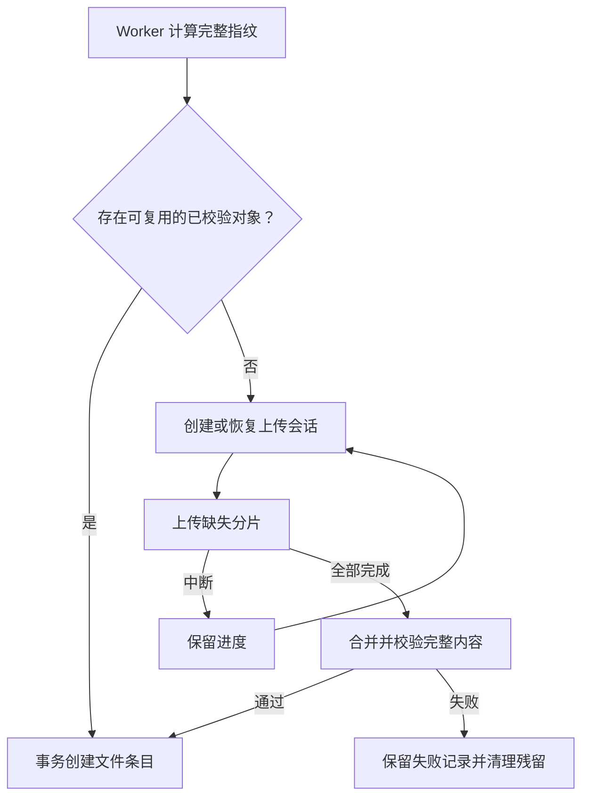
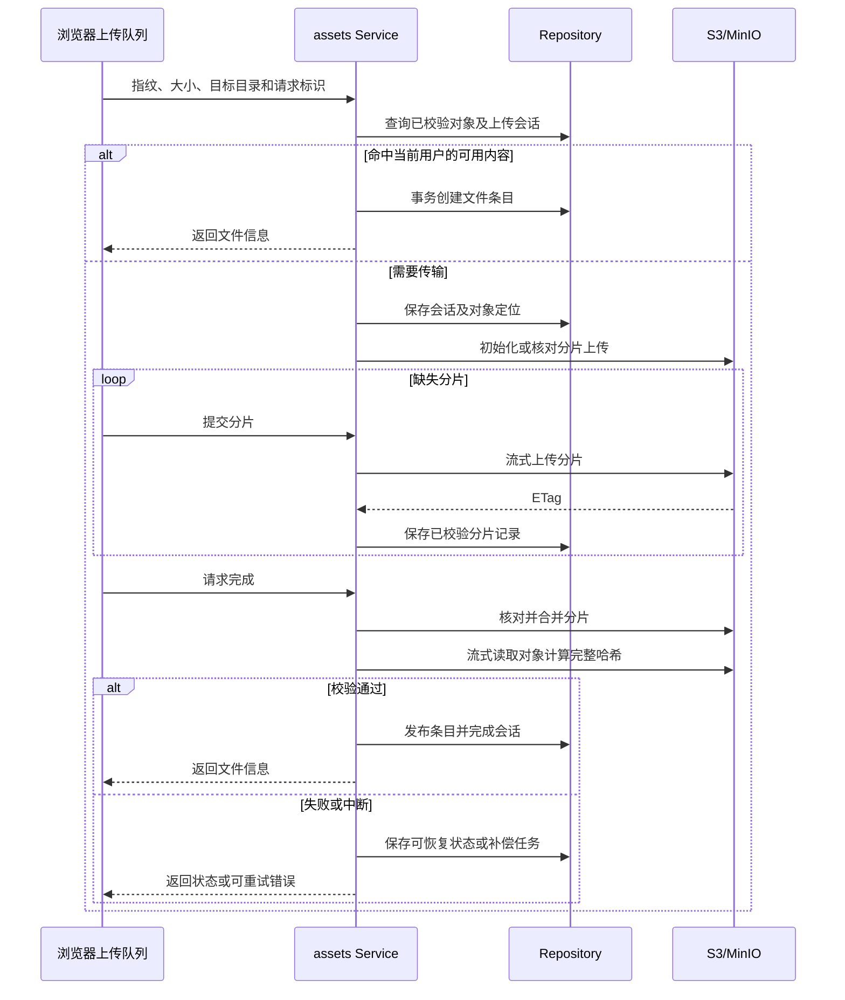
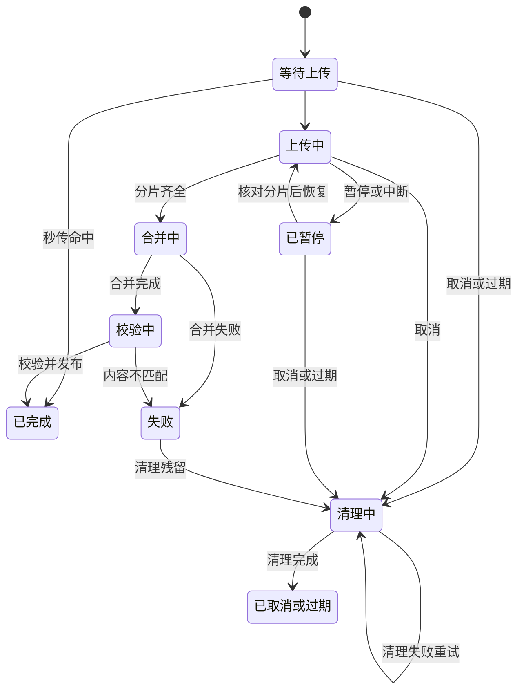
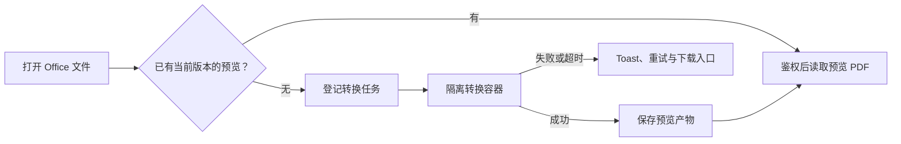
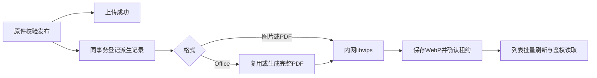
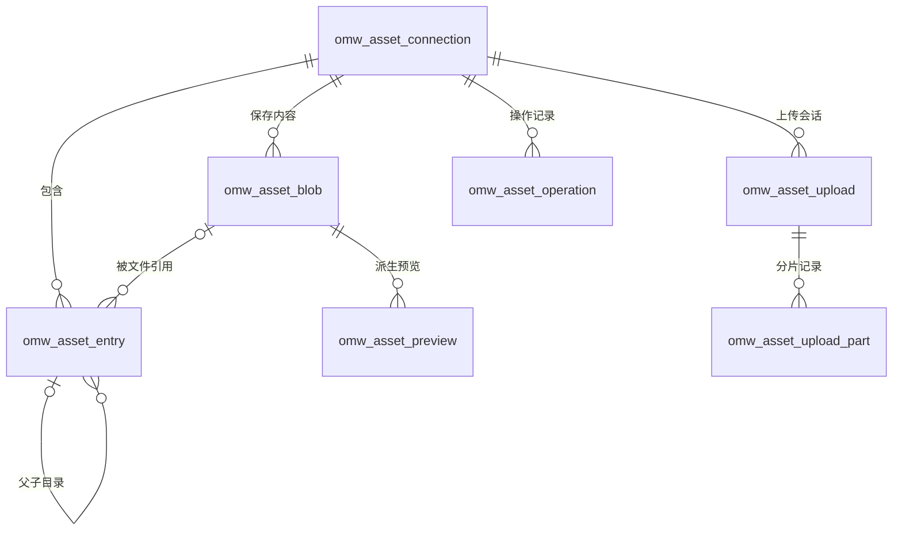
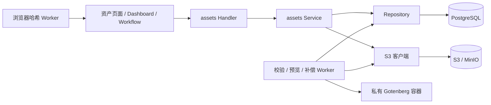

# 资产模块设计方案

本文汇总资产存储、保存视图、分片上传、断点续传、秒传和文件预览的讨论方案。用户于 2026-10-30 要求依据本方案实施，现已实现主要功能并完成工程与真实存储验证；重负载性能及完整故障矩阵尚未完成。配置见 `apps/api/internal/modules/assets/README.md`。

## 1. 目标与范围

将现有资产页面接入真实 S3/MinIO，保留目录树、列表与网格、收藏、最近访问、回收站和批量操作，并增加可保存规则的资产视图、大文件上传和按需预览。

本期管理工作台登记在 Bucket 专用前缀中的文件。外部 Bucket 存量扫描、分享链接、在线协作编辑和音视频转码不包含在当前范围中。

实施前的前端入口为 `apps/web/src/features/assets/`。实施前目录和文件元数据保存在浏览器 localStorage，上传内容保存在 IndexedDB；存储重连仅更新本地状态，后端尚无资产模块。

## 2. 核心设计

将逻辑文件、物理内容和上传过程分开管理：

- **文件条目**：保存名称、目录位置、收藏、访问和回收站状态。
- **内容对象**：保存不可变的文件内容及服务端校验结果，可以被多个文件条目引用。
- **上传会话**：保存上传目标、对象存储 Upload ID、分片进度和恢复状态。
- **资产视图**：保存查询规则和排序，每次打开重新查询当前匹配结果。
- **预览产物**：按内容对象及渲染器版本生成和缓存，不修改原始文件。

PostgreSQL保存业务数据，S3/MinIO保存原文件和派生产物。新对象使用 `workbench/{userId}/{blobId}/original.<受控扩展名>`，同组保存预览PDF和缩略图，不拼接用户输入的目录。旧 `blobs/{blobId}` 路径及已有预览Key继续按数据库记录读取，不批量搬迁。

文件夹是数据库中的逻辑目录。重命名和移动只改变元数据；同存储复制可以新建文件条目并复用内容对象。后续替换内容需要创建新对象，避免影响其他引用。

## 3. 保存视图

### 3.1 导航和交互

- 将左侧“资产”分组改为“视图”，分组标题右侧提供新增入口。
- 预置“全部文件”“最近访问”“收藏”，支持编辑名称、图标、规则和排序。
- 支持新增和删除视图，至少保留一个活动视图。
- 将“回收站”放入“管理”分组，保留恢复和彻底删除能力。
- “存储”分组继续展示真实存储连接及逻辑目录树。

| 示例视图 | 规则 |
| --- | --- |
| 工作文档 | 所属存储是“工作资料” AND 文件类型是“文档” |
| 常用图片 | 已收藏 AND 文件类型是“图片” |
| 大文件 | 文件大小大于 10MiB |

### 3.2 规则契约

视图保存名称、图标、完整规则 AST 和排序。字段覆盖文件名、文件类型、所属存储、大小、收藏状态、创建时间、修改时间和访问时间。

复用共享 `RuleFilters`：列表使用默认弹出模式，视图编辑表单使用 `mode="inline"`。业务页面只提供字段、查询、变更回调和必要业务文案，不复制筛选面板或操作栏。

规则使用与 Todo 一致的 `schemaVersion=1` 协议，保留 AND、OR、NOT 与嵌套语义。后端复用通用规则引擎校验，再由 Repository 转换为白名单字段的参数化查询。

列表临时搜索和筛选与已保存规则按 AND 组合，只有执行保存视图才改变长期配置。查询、总数和分页使用同一套条件。

请求携带 `viewId`，服务端读取当前用户的视图。用户隔离和回收站可见性始终作为额外业务条件，不能被视图规则覆盖。引用失效时提示并提供编辑入口，不静默扩大查询范围。

`builtin_key` 用于兼容原“最近访问”“收藏”的定位链接。预置视图被删除后不自动补回。

## 4. 上传方案

### 4.1 建议默认值

| 项目 | 默认值 |
| --- | --- |
| 单文件大小上限 | 10GiB |
| 启用分片的文件大小 | 大于或等于 32MiB |
| 分片大小 | 8MiB |
| 单文件并发分片数 | 3 |
| 整个队列并发分片数 | 6 |
| 每批文件数 | 最多 200 个 |
| 上传会话保留时间 | 最后活动后 7 天 |

这些值是待确认的应用默认值，不是对象存储产品上限。此前讨论的单文件 20MB 和批次总量 200MB 限制由本节替代。

小文件使用单次上传路径，空文件单独处理；大文件使用 S3/MinIO 原生 Multipart Upload，不在本地磁盘拼接整文件。

### 4.2 分片上传

1. 客户端计算文件指纹，并申请创建或恢复上传会话。
2. 服务端校验身份、存储、目标目录、文件名和大小。
3. 未命中秒传时，持久化上传会话并初始化对象存储分片上传。
4. 浏览器使用 `Blob.slice()` 切片，经后端流式转发到对象存储。
5. 服务端校验分片实际字节和大小，记录编号、SHA-256、ETag 及完成状态。
6. 分片齐全后核对记录，按分片编号提交完成请求。
7. 完成内容校验后发布文件条目，进入列表、视图和统计。

分片独立重试，重复请求需要保持幂等。同编号的并发请求、完成和取消操作需要状态及租约协调，避免迟到结果覆盖新状态。网络传输期间不持有数据库长事务。

### 4.3 断点续传

服务端数据库是上传进度的持久化依据，浏览器 IndexedDB 只保存任务定位和界面恢复信息，不缓存整份大文件。

恢复时核对数据库中的已确认分片与对象存储 `ListParts` 结果，只补传缺失或无效分片。分片列表需要正确处理对象存储分页；`ListParts` 用于核对，完成上传仍使用应用保存的分片编号和 ETag 清单。

上传队列提供暂停、继续、取消和失败重试。刷新页面后恢复任务记录；恢复实际传输时，默认需要重新选择原文件，并验证完整指纹一致，不能仅凭文件名和大小匹配。

暂停保留已完成分片。取消或过期后停止接受新分片，并处理在途请求、终止分片上传、核对清理结果。清理失败进入持久化重试，不能只删除本地任务记录。

服务端重启后根据上传会话、对象清理状态和对象存储结果恢复。完成请求超时不等同于合并失败，需要先核对实际对象，避免重复发布文件或遗留内容。

### 4.4 秒传和内容校验

秒传匹配范围限定为当前用户、同一存储连接中仍可用且已完成服务端校验的内容对象，使用完整 SHA-256 与文件大小定位。命中后重新校验对象和引用状态，在事务中创建新的文件条目。

不同用户、不同存储之间不共享秒传结果，也不暴露其他用户是否拥有某个哈希对应的文件。

客户端使用 Web Worker 增量计算完整 SHA-256，拟采用 `hash-wasm`，不自行实现哈希算法。浏览器原生 `SubtleCrypto.digest()` 不支持流式输入，不适合直接读取整个大文件计算。

客户端声明的哈希不直接写入可信索引：

- 单次上传可以在服务端读取上传字节时计算完整哈希。
- 分片上传在合并后，由服务端流式读取实际对象计算完整 SHA-256，通过后才发布文件。
- 分片 SHA-256 不能拼接为完整文件 SHA-256，S3 ETag 也不能作为完整文件哈希。
- 校验失败不发布文件，保留失败结果并清理残留。

秒传省去再次上传，但本地指纹计算仍需要读取文件。首次大文件上传后的服务端校验还会产生一次完整读取，界面需要分别展示“计算指纹”“上传中”“校验中”“完成”。







## 5. 文件管理与内容生命周期

目录采用 `parent_id` 邻接关系，保留最多 64 层限制。文件和文件夹共用名称空间，同目录名称校验、目录环检查和批量变更在 Repository 的短事务中完成，锁定对应存储连接以维护一致性。

重命名、移动和收藏不改变内容对象。更新携带 `version`，冲突返回 `409`，保留草稿并提供重载或重试入口。同名文件不得静默覆盖。

删除先进入回收站。父目录删除时隐藏后代，恢复父目录保留子项此前独立删除的状态；原父目录不可用时可恢复到存储根，同名内容保留为副本。

彻底删除必须确认。先解除当前条目的内容引用，包含回收站文件在内的最后一个引用消失后，才允许清理物理对象及预览产物。内容引用创建和对象清理状态在事务中协调，防止秒传或复制正在引用的内容被删除。

版本化 Bucket 保存并使用具体对象版本。对象清理失败保留持久化记录，不伪报内容已清理成功。

## 6. 文件预览

### 6.1 格式与方式

现有预览先读取整个文件 Blob；新方案使用有界读取、Range 请求或私有转换，避免大文件必须完整下载后才能开始预览。

| 类型 | 预览方式 | 边界 |
| --- | --- | --- |
| PNG、JPEG、GIF、WebP 等常见图片 | 浏览器图片查看，提供缩放及原图下载 | 校验实际格式，设置预览文件大小与像素上限 |
| PDF | PDF.js 按页渲染，支持翻页、缩放和文本选择 | Range 按需读取，解析放入 Worker |
| TXT、日志、代码、JSON | 有界文本读取；代码复用 Shiki，JSON 格式化 | 默认读取前 512KiB，大文件可下载 |
| Markdown | marked 解析，DOMPurify 清洗 | 禁止脚本和自动加载外链资源 |
| CSV、TSV | 有界表格预览 | 限制字节数、行数和列数 |
| Word、Excel、PPT | 私有转换服务生成 PDF，再交给 PDF.js | Excel 首版按打印分页阅读 |
| 音频、视频 | 浏览器原生播放器 | Range 支持拖动进度，编码兼容性由浏览器决定 |
| HTML、SVG | 源码预览 | 不将上传内容作为应用页面执行 |
| 未知格式 | 文件详情和下载 | 不自动执行或解压文件 |

### 6.2 Office 转换

采用私有部署的 Gotenberg/LibreOffice 容器。后端读取原文件，传入转换服务，接收 PDF 并保存到对象存储，浏览器经鉴权接口访问结果。

Office上传校验发布后异步登记预览PDF与缩略图；打开旧文件时仍可按需补齐。缓存以内容对象、源对象版本和渲染器版本定位，完整PDF同时供阅读预览和首页缩略图使用。重命名、移动和收藏不触发重新转换；多个条目共享同一内容对象的产物。

建议初始限制为 Office 源文件 50MiB、转换超时 60 秒。转换容器设置 CPU、内存和网络限制，禁用文档宏与外链资源，并配置中文字体。超出预览限制的文件仍可保存和下载。

Excel 首版提供按打印分页的阅读预览，字体、分页、复杂公式或排版可能与原应用有差异。媒体首版使用浏览器解码，不增加转码服务。



### 6.3 上传后异步缩略图

沿用 `omw_asset_preview`，用 `gotenberg-pdf-v1` 和 `thumbnail-512-v1` 两种规格区分完整PDF与缩略图，无新增表或字段。图片JPEG/PNG/WebP/GIF首帧经内网libvips缩放，PDF渲染首页，Office复用Gotenberg完整PDF再生成首页。固定512px包围框、保持比例、只缩小、校正EXIF方向、保留透明度，输出WebP，最大2MiB。新增MOV/MP4/WebM/AVI（最大100MiB）经私有FFmpeg截帧；CSV/TSV和TXT/JSON/TOML/HTML等文本仅取512KiB前缀，由服务端转义并绘制摘要，HTML不执行。

发布原件与创建派生记录同事务完成，上传成功不等待生成。图片原件最大32MiB/50MP，PDF/Office原件最大50MiB；超限或不支持的文件仍可存取并显示类型图标。图片渲染并发2，Office转换并发1，渲染服务不可用不消耗文件重试；文件错误有界重试，失败可通过菜单重新生成。Office依赖等待不消耗重试，网络写入结果不确定时保留原租约，清理同时回收稳定Key下的对象版本和未完成分片会话。

新上传在校验后写入正确Content-Type；旧文件补齐缩略图时保留原Key、按已验证类型补正元数据，旧版本保留给已经开始的下载。旧文件每轮游标读取20项补齐，当前页先批量查询已有缓存、批量入队并优先处理，不扫描Bucket、不逐卡片查询状态。

列表返回可选 `thumbnail: {status,version?}`。`GET/HEAD /entries/:id/thumbnail`按Entry鉴权，权限检查后处理ETag/304，响应为私有可协商缓存；`POST`同一路径重试失败生成。前端仅当前页存在待生成记录时每5秒批量刷新，隐藏页面暂停；图片懒加载并预留固定空间，失败回退文件图标，不向上传弹窗或传输队列加入派生任务。



### 6.4 读取与界面边界

预览、下载和每个 Range 请求都校验当前文件条目的用户归属和可见性。内容来源固定为已登记的对象 Key，不接受客户端提供任意远程 URL。

PDF、音视频通过同源内容接口按需读取；文本和结构化预览有明确读取上限。正确返回 `Content-Type`、`Content-Length`、`Accept-Ranges`、`Content-Range`，覆盖 `206` 和无效范围的 `416` 响应。

关闭、切换文件或退出登录时取消请求，释放渲染任务和对象 URL，避免迟到响应覆盖当前文件或其他登录用户的状态。

界面使用现有 Dialog、Skeleton、Button 和 Toast。加载显示真实布局的 Skeleton，失败保留重试和下载入口；错误只通知一次，不重复添加底部错误说明。

## 7. 表结构设计

### 7.1 通用规范

所有业务表均包含以下字段：

```sql
id         BIGINT PRIMARY KEY,
user_id    BIGINT NOT NULL,
created_at TIMESTAMPTZ NOT NULL,
updated_at TIMESTAMPTZ NOT NULL
```

ID 使用现有 `idgen.Next()` 统一生成，HTTP JSON 中以字符串传输，避免 JavaScript 数字精度丢失。关联、状态和去重由代码及事务维护，不增加外键、CHECK 或数据库枚举。通过新增 Goose SQL 文件执行增量迁移。

以下为业务字段设计；公共字段不在每张表中重复列出。

### 7.2 omw_asset_connection

| 字段 | 类型 | 用途 |
| --- | --- | --- |
| name | VARCHAR(100) | 显示名称 |
| endpoint | TEXT | S3 服务地址 |
| region | VARCHAR(64) | 区域 |
| bucket | VARCHAR(63) | Bucket 名称 |
| prefix | TEXT | 工作台管理前缀 |
| credential_ciphertext | BYTEA | 加密后的访问凭证 |
| enabled | BOOLEAN | 是否启用 |
| last_checked_at | TIMESTAMPTZ，可空 | 最近真实检查时间 |
| last_error | TEXT，可空 | 最近检查错误 |
| version | INTEGER | 更新冲突检测 |

### 7.3 omw_asset_entry

| 字段 | 类型 | 用途 |
| --- | --- | --- |
| connection_id | BIGINT | 所属存储连接 |
| parent_id | BIGINT，可空 | 父文件夹，空表示存储根 |
| kind | VARCHAR(16) | 文件或文件夹 |
| name | VARCHAR(200) | 显示名称 |
| normalized_name | VARCHAR(200) | 同目录名称校验键 |
| blob_id | BIGINT，可空 | 文件内容引用，文件夹为空 |
| content_type | VARCHAR(255) | 文件媒体类型 |
| starred | BOOLEAN | 收藏状态 |
| last_opened_at | TIMESTAMPTZ，可空 | 最近访问时间 |
| trashed_at | TIMESTAMPTZ，可空 | 本条目独立进入回收站的时间 |
| status | VARCHAR(16) | 条目发布或清理状态 |
| version | INTEGER | 更新冲突检测 |

物理对象定位、大小和可信哈希归内容表，避免与条目重复保存。逻辑文件数量及容量按文件条目统计，上传中、校验中的对象不计入可用文件。

### 7.4 omw_asset_blob

| 字段 | 类型 | 用途 |
| --- | --- | --- |
| connection_id | BIGINT | 所属存储连接 |
| sha256 | CHAR(64)，可空 | 完整内容哈希，通过服务端校验后可信 |
| size_bytes | BIGINT | 实际文件大小 |
| object_key | TEXT | 原文件对象 Key |
| object_version_id | TEXT，可空 | 对象版本 |
| etag | TEXT，可空 | 对象存储返回的 ETag |
| status | VARCHAR(16) | 上传、校验、可用或清理状态 |
| verified_at | TIMESTAMPTZ，可空 | 完整内容校验时间 |

秒传查询使用当前用户、连接、哈希、大小和可用状态。清理前检查所有有效内容引用，并以事务状态防止引用创建与清理竞争。

### 7.5 omw_asset_upload

| 字段 | 类型 | 用途 |
| --- | --- | --- |
| connection_id | BIGINT | 目标存储连接 |
| blob_id | BIGINT，可空 | 上传关联的内容对象 |
| parent_id | BIGINT，可空 | 目标文件夹 |
| file_name | VARCHAR(200) | 目标文件名 |
| content_type | VARCHAR(255) | 声明及校验后的媒体类型 |
| expected_sha256 | CHAR(64) | 客户端声明的完整指纹 |
| size_bytes | BIGINT | 声明的文件大小 |
| part_size | BIGINT | 会话固定分片大小 |
| part_count | INTEGER | 预期分片数量 |
| s3_upload_id | TEXT，可空 | 对象存储分片会话标识 |
| request_key | VARCHAR(64) | 初始化请求去重标识 |
| status | VARCHAR(16) | 会话状态 |
| expires_at | TIMESTAMPTZ | 会话失效时间 |
| last_error | TEXT，可空 | 最近失败原因 |
| version | INTEGER | 状态更新冲突检测 |

会话记录发布结果和必要的执行租约，支持请求重试、完成状态核对及重启恢复。完成发布前重新校验目标目录；目标不可用时保留可恢复结果，避免静默改存到其他位置。

### 7.6 omw_asset_upload_part

| 字段 | 类型 | 用途 |
| --- | --- | --- |
| upload_id | BIGINT | 所属上传会话 |
| part_number | INTEGER | 从 1 开始的分片编号 |
| size_bytes | BIGINT | 实际分片大小 |
| sha256 | CHAR(64) | 实际分片校验值 |
| etag | TEXT，可空 | 对象存储确认值 |
| status | VARCHAR(16) | 分片处理状态 |

同一会话和分片编号的请求由代码维护幂等与在途协调；只有完成校验的分片参与合并。

### 7.7 omw_asset_operation

批量操作的请求防重与结果记录，共9列；基础字段为id、user_id、created_at、updated_at。

| 字段 | 类型 | 用途 |
| --- | --- | --- |
| connection_id | BIGINT | 所属存储，供删除清理完成时更新结果 |
| kind | VARCHAR(16) | 复制、移动、收藏、回收、恢复、永久删除 |
| status | VARCHAR(16) | completed，或永久删除仍在清理时的cleaning |
| request_key | VARCHAR(64) | 同用户请求去重标识 |
| payload | JSONB | 原始批量请求，用于拒绝同一标识携带不同参数 |

批量元数据变更与请求记录在同一事务提交；重复请求直接返回已有结果。物理删除由blob状态驱动重试，操作记录只随清理完成更新结果。移除未使用的root_entry_id、attempts、next_retry_at、lease_token、lease_until、last_error以及调度索引；清理状态使用(user_id,connection_id)的局部索引。payload不保存文件内容或访问凭证。

### 7.8 omw_asset_view

| 字段 | 类型 | 用途 |
| --- | --- | --- |
| name | VARCHAR(100) | 视图名称 |
| icon | VARCHAR(64) | 图标键 |
| builtin_key | VARCHAR(16)，可空 | 预置视图与旧链接兼容标识 |
| filter_query | JSONB | 完整通用规则 AST |
| sort | VARCHAR(16) | 排序方式 |
| version | INTEGER | 更新冲突检测 |
| deleted_at | TIMESTAMPTZ，可空 | 视图软删除时间 |

### 7.9 omw_asset_preview

| 字段 | 类型 | 用途 |
| --- | --- | --- |
| blob_id | BIGINT | 源内容对象 |
| renderer_version | VARCHAR(64) | 固定产物规格：预览PDF或512px缩略图 |
| status | VARCHAR(16) | 等待、生成、可用或失败状态 |
| object_key | TEXT，可空 | 预览产物对象 Key |
| object_version_id | TEXT，可空 | 产物精确对象版本，避免读取被覆盖版本 |
| size_bytes | BIGINT | 有界读取与内容响应所需的产物大小 |
| last_error | TEXT，可空 | 最近生成错误 |
| attempts | INTEGER | 尝试次数 |
| next_retry_at | TIMESTAMPTZ | 下次重试时间 |
| lease_token | VARCHAR(64)，可空 | 生成任务租约标识 |
| lease_until | TIMESTAMPTZ，可空 | 租约截止时间 |

源版本由不可变 blob 及其对象版本确定，产物按源内容与渲染器版本关联。

### 7.10 关系与索引

以下为逻辑关联，不创建数据库外键。



主要索引覆盖：

- 条目目录和名称：`(user_id, connection_id, parent_id, normalized_name)`。
- 最近访问、收藏、回收站：当前用户、对应状态、时间与 ID。
- 秒传：`(user_id, connection_id, sha256, size_bytes, status)`。
- 上传分片：`(user_id, upload_id, part_number)`。
- 请求去重：当前用户与 `request_key`。
- 上传过期清理：会话状态与 `expires_at`。
- 对象清理和预览：状态、`next_retry_at`、租约截止时间；操作结果只索引待清理的用户与存储。
- 视图：`(user_id, deleted_at, created_at, id)`。

## 8. 架构与模块职责

沿用现有 Handler → Service → Repository 分层。所有 SQL、GORM 及其他持久化访问位于 Repository，Service 只负责业务校验、状态规则和调用编排。

```text
apps/api/internal/modules/assets/
  routes.go        路由与认证入口
  handler.go       请求校验、上传和内容响应
  service.go       业务规则与状态编排
  repository.go    数据库查询、事务与租约
  model.go         持久化模型
  dto.go           接口契约
  s3.go            对象存储访问
  credentials.go   存储凭证加解密
  worker.go        校验、预览、恢复与补偿任务
```

上传、预览和视图的实现按职责放入同一模块，文件在实现规模需要时再拆分，不预建通用插件或工作流框架。



前端在 `features/assets` 中维护请求层、业务状态和操作 Hook，复用现有页面组件。退出登录或切换身份时取消请求并清空远端快照，防止旧响应回写。

Dashboard、活动图和 Workflow 使用服务端汇总，不使用当前页文件列表推算总数。文件上传成功、移动、删除或恢复后更新相关查询和统计。

### 8.1 复用与依赖

复用现有 AppShell、InnerPanel、目录树、RecordsGrid、RuleFilters、Dialog、AlertDialog、Sonner、DOMPurify、Shiki、登录态、idgen、Goose 和通用规则引擎。

拟新增的必要依赖为：

- `minio-go/v7`：S3/MinIO 对象与分片 API。
- `hash-wasm`：浏览器 Worker 中的增量 SHA-256。
- `pdfjs-dist`：按页 PDF 预览，按需加载。
- `marked`：Markdown 解析，输出仍由现有 DOMPurify 清洗。
- 私有 Gotenberg/LibreOffice 转换容器：Office 预览。

批量操作使用轻量请求结果记录防重；上传会话与对象清理状态处理数据库和对象存储之间的提交边界。内容对象不可变、文件条目引用内容，解决秒传与复制的真实复用需求。其他部分直接实现更清晰，不额外引入抽象框架。

## 9. API 草案

统一挂载到登录态保护的 `/api/assets`。以下是待实施的接口草案。

| 方法与路径 | 用途 |
| --- | --- |
| `GET /overview` | 数量、逻辑容量、近期文件、活动与连接汇总 |
| `GET /connections` | 查询连接 |
| `POST /connections` | 新增连接 |
| `PATCH /connections/:id` | 修改连接配置或启用状态 |
| `POST /connections/:id/test` | 真实连接和权限检查 |
| `POST /entries/query` | 按目录或视图进行游标连续加载、搜索、规则筛选与排序（兼容旧分页） |
| `POST /folders` | 新建文件夹 |
| `PATCH /entries/:id` | 重命名、收藏和访问记录 |
| `POST /entries/batch` | 移动、复制、回收、恢复和彻底删除 |
| `POST /uploads/init` | 秒传检查、初始化或恢复上传 |
| `GET /uploads` | 当前用户的可恢复上传任务 |
| `GET /uploads/:id` | 会话状态及分片核对结果 |
| `PUT /uploads/:id/parts/:partNumber` | 提交单个分片 |
| `PATCH /uploads/:id` | 暂停或恢复 |
| `POST /uploads/:id/complete` | 提交完成，进入合并、校验与发布流程 |
| `DELETE /uploads/:id` | 取消并安排清理 |
| `GET /entries/:id/content` | 鉴权内容读取、预览与下载，支持 Range |
| `POST /entries/:id/preview` | 按需申请预览产物 |
| `GET /entries/:id/preview` | 查询预览状态及可用产物信息 |
| `GET /views` | 查询资产视图 |
| `POST /views` | 创建资产视图 |
| `PATCH /views/:id` | 更新规则、名称、图标与排序 |
| `DELETE /views/:id` | 软删除视图 |
| `GET /operations/:id` | 查询批量操作结果和删除清理状态 |

初始化结果区分秒传完成、单次上传和分片会话。分片与内容接口使用二进制流，其余接口沿用现有响应信封、字符串 ID 和错误处理约定。

## 10. 安全、兼容与迁移

- 用户归属从登录态获取，不信任客户端提交的 `user_id`。
- 存储凭证使用工作台自动生成并持久保存的内部密钥加密，接口不返回凭证原文，不要求用户配置资产专用环境变量。
- Endpoint 通过连接表单配置；固定请求源，校验并绑定 DNS 解析 IP，拒绝元数据地址和 DNS 重绑定，支持明确指定的内网 MinIO。
- 通过真实请求检查连接及所需权限，检查失败不伪造正常状态。
- 已有文件时保持 Bucket、前缀等定位信息稳定；暂停连接不删除内容。
- 原始文件和预览产物均通过鉴权访问，不依赖公开 Bucket 或公开 Office 查看服务。
- 保存当前浏览器本地数据，提供用户主动触发的可重试导入，成功后记录旧 ID 映射并兼容原定位链接；不提前清除原文件副本。
- 不将示例连接自动认作真实可用存储，也不替用户自动创建或公开 Bucket。
- 迁移使用新增 Goose SQL，不修改既有已执行迁移。

适用项目约束包括 PRJ-0002 至 PRJ-0009、PRJ-0011 至 PRJ-0014。至少保留一个资产视图是本次提出的产品规则，与 Todo 的现有行为保持一致。

本轮不提交 Git、不创建工作树、不使用多智能体。确认后的设计再同步到项目上下文中的正式功能设计，保留已有历史记录。

## 11. ReUI 实施计划

| 项目 | 方案 |
| --- | --- |
| Surface | 日常操作页 |
| Archetype | 表格管理 |
| Container | 沿用 RecordsGrid 的现有 Card 容器 |
| Density | 紧凑，使用已有 sm 控件尺寸 |
| Regions | 左侧视图和目录树；主区路径、工具栏、列表或网格、连续加载页脚；上传与预览弹窗 |
| States | Skeleton、带操作的空态、失败重试；错误与操作反馈统一 Toast |
| Motion | 不新增入场动画 |

保留共享导航、侧栏拖宽与窄屏抽屉，统一字体和表格密度，不新增解释实现机制的标语、说明或次要标签。加载失败保留可操作的重试入口，错误详情按 PRJ-0012 使用 Toast，避免重复展示。

## 12. 验收与验证

### 12.1 功能与可靠性

- 真实上传和下载字节一致，目录上传保持层级。
- 文件和目录同名、并发更新、目录环、跨存储限制及最大深度。
- 保存视图刷新恢复，嵌套 AND/OR/NOT、临时筛选、失效引用和最后一个视图保护。
- 分片边界、空文件、重复分片、失败重试和重复完成请求。
- 断网、刷新、重新选择文件、服务进程重启后续传。
- 暂停、取消、过期、在途分片与清理失败恢复。
- 哈希伪造、内容不匹配、当前用户秒传与跨用户隔离。
- 多个条目共享内容、回收站引用、最后引用删除和清理竞争。
- 父子目录回收、独立删除状态、恢复冲突、复制失败与补偿。
- Range 的 206/416、PDF 按页读取、文本截断、播放器拖动进度。
- Office 转换缓存、字体、超时、异常文档及重试。
- Dashboard、活动及 Workflow 统计与定位链接。
- 桌面、390px、深色主题、键盘焦点、加载/空/失败状态。

### 12.2 工程与性能

执行相关 Go 和前端测试、类型检查、lint、build、ReUI 两轮自检及完整 diff 检查；测试与夹具按项目规则保留本地。

元数据接口拟采用 1 万条目、20 并发、30 秒预热、120 秒正式负载，待确认目标为 p95 不高于 300ms、p99 不高于 800ms、吞吐不低于 50 次/秒、无故障阶段错误率为 0。

分片传输、完整内容校验和预览转换分别测量，记录实际 p95、p99、吞吐、错误率及资源消耗，不混成一个上传耗时。上传和转换尚无确认的生产 SLO，需要同环境实测形成基线；正式 p99 统计至少包含 1000 个有效样本，故障注入结果单独分析。

## 13. 主要取舍与风险

- 首次大文件计算指纹和服务端完整校验会增加读取时间；需要真实展示阶段进度。
- 后端代理传输适配内网 MinIO，带宽也受 API 服务资源影响，需实测并发和内存边界。
- 上传会话、对象存储和数据库不能使用一个跨系统事务，需要持久化状态、核对与补偿。
- 内容复用降低重复存储，但引用创建和物理清理必须保证并发一致性。
- Office 预览需要额外的私有转换容器及中文字体，复杂文档排版可能存在差异。
- 音视频预览受浏览器编码支持限制，首版不转码。
- 原浏览器数据在导入成功前保持原样，回滚或失败恢复不能依赖清空浏览器数据。

## 14. 技术参考

- [AWS S3 对象与 Key 模型](https://docs.aws.amazon.com/AmazonS3/latest/userguide/object-keys.html)
- [AWS S3 分片上传流程与完整性校验](https://docs.aws.amazon.com/AmazonS3/latest/userguide/mpuoverview.html)
- [AWS S3 分片限制](https://docs.aws.amazon.com/AmazonS3/latest/userguide/qfacts.html)
- [MinIO Go SDK](https://github.com/minio/minio-go)
- [hash-wasm 增量哈希 API](https://github.com/Daninet/hash-wasm)
- [MDN SubtleCrypto.digest](https://developer.mozilla.org/en-US/docs/Web/API/SubtleCrypto/digest)
- [MDN HTTP Range 请求](https://developer.mozilla.org/en-US/docs/Web/HTTP/Guides/Range_requests)
- [PDF.js API](https://mozilla.github.io/pdf.js/api/draft/api.js.html)
- [Marked 与 HTML 清洗](https://marked.js.org/)
- [Gotenberg Office 转 PDF](https://gotenberg.dev/docs/convert-with-libreoffice/convert-to-pdf)
- [Gotenberg 出站访问控制](https://gotenberg.dev/docs/outbound-url-filtering)

2026-10-30 使用反馈修正：未配置连接属于正常空态；移除全部资产专用环境变量，密钥由工作台自动管理，私有 Office 服务使用固定内部接入地址。


### 游标连续浏览与阅读工具栏（2026-11-01）

资产查询增加cursorMode/cursor，返回nextCursor/hasMore；按文件夹优先、指定排序值、ID稳定继续读取，不使用OFFSET或逐批COUNT。游标绑定用户和完整条件，每次仍鉴权；删除锚点不影响继续读取。旧page/pageSize接口保留兼容。前端每批50项，滚动加载与去重，失败原位重试；列表/网格使用已安装TanStack Virtual，保留筛选、排序、勾选和固定布局。元数据缓存包含当前全部已加载项和最多600项近期缓存，服务端每批操作200项的上限不变，选择入口明确表达该边界。

预览标题/工具栏/阅读区/文件切换区各自稳定。图片以原始尺寸计算比例，默认适应窗口；PDF默认适应宽度且不超过原尺寸，居中并保留文本选择，比例菜单提供适应窗口/宽度，另有1:1和页码导航。CSV首行作为表头、完整长单元格换行与水平滚动、可变行高虚拟化，最多10000行100列，边界明确显示；不再嵌套页码栏。压缩包通过共享FileTypeIcon使用压缩文件字形。
